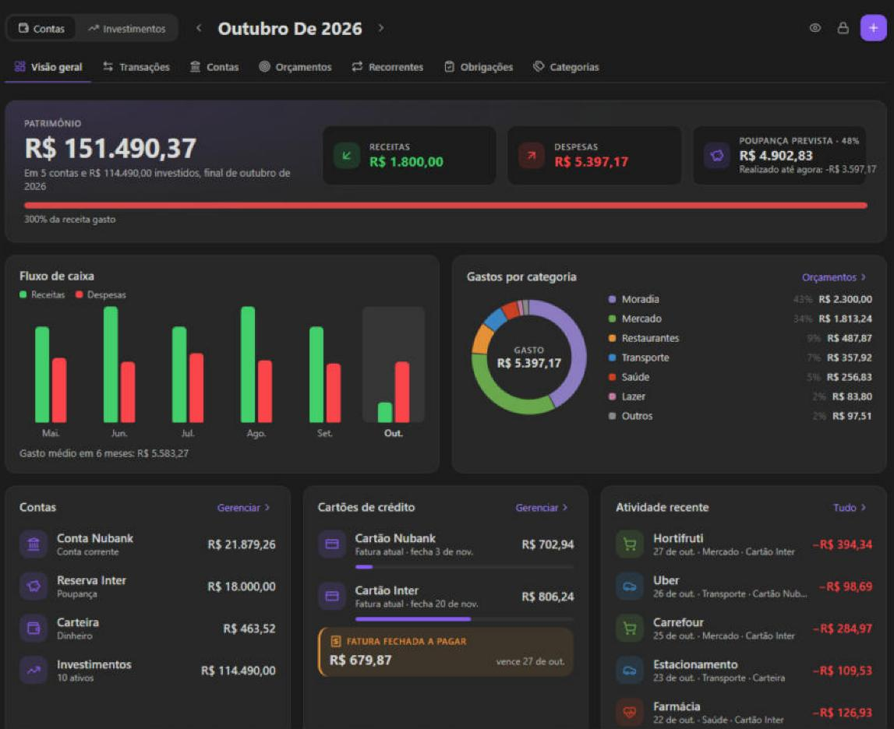
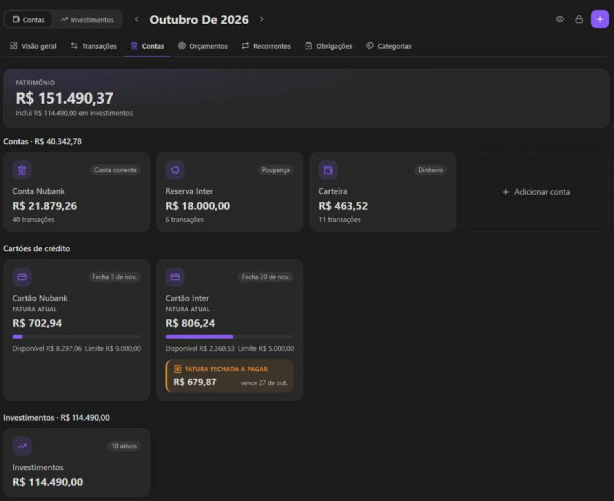
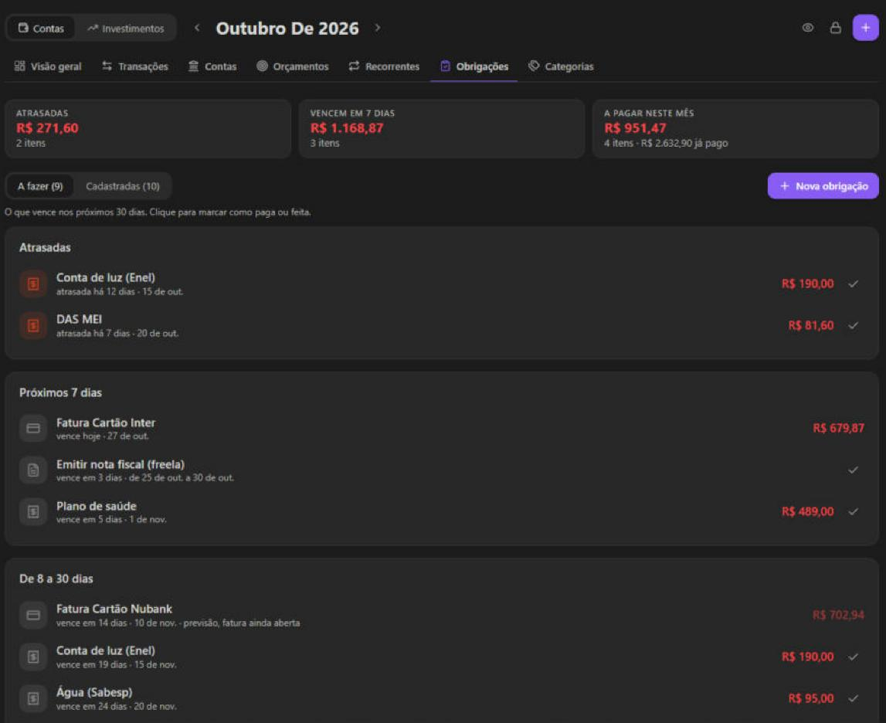
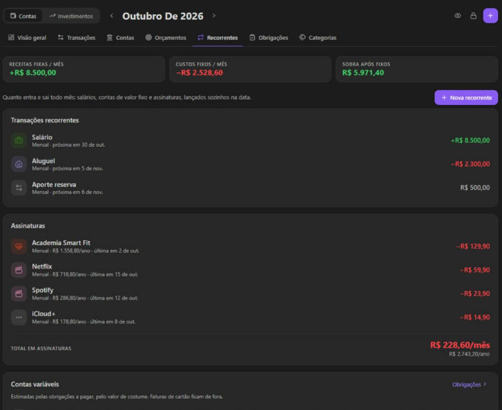
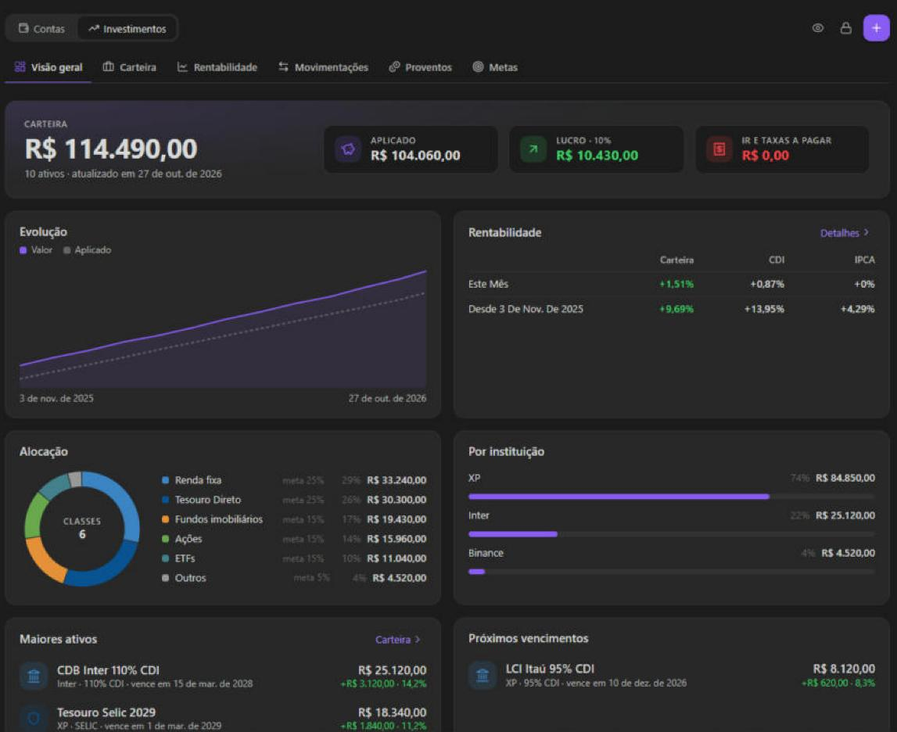
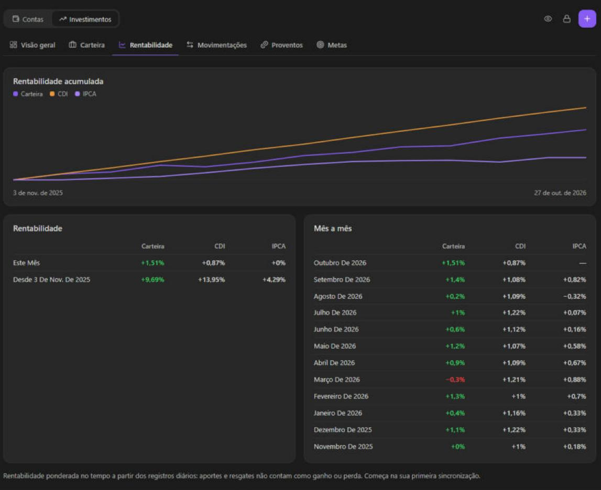
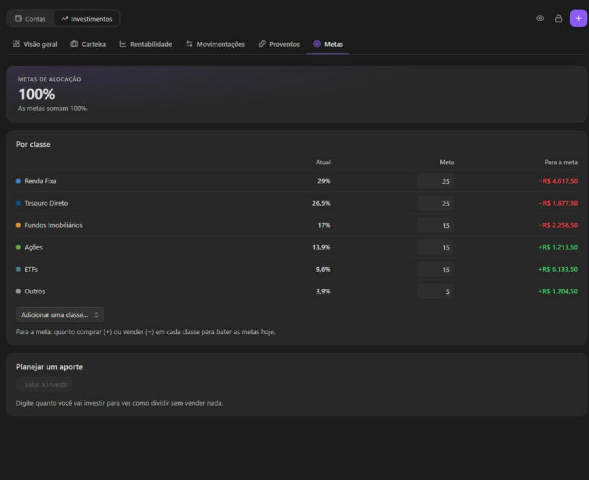
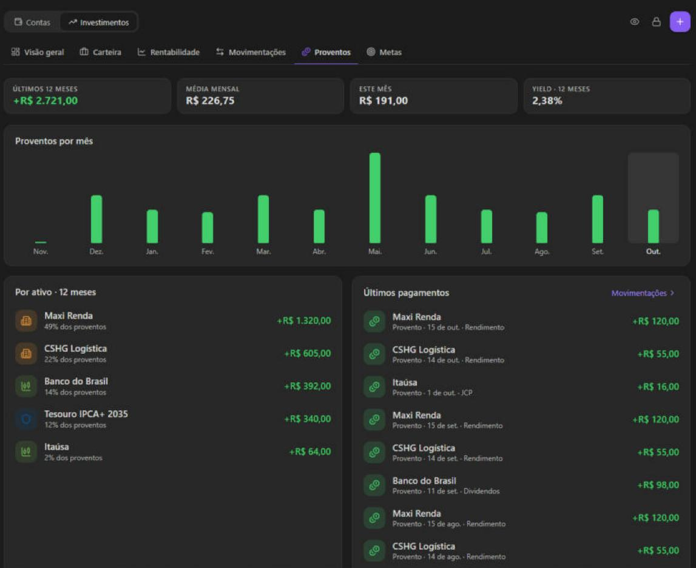

# Trimly

Personal finance manager for [Obsidian](https://obsidian.md), with **everything encrypted at rest**.

Your vault may be synced or pushed to a Git remote; your finances shouldn't be readable there. Trimly
stores all of its data in a single file encrypted with AES-256-GCM, using a key derived from a
passphrase that never leaves your device.

> **Built for Brazil.** Trimly is made for people who keep their money in Brazil: the interface is in
> Brazilian Portuguese first, bank sync uses Brazilian Open Finance (Pluggy), quotes and proventos
> come from B3, returns are compared with CDI, IPCA, poupança, IBOV and IFIX, and features like
> *Obrigações* (DAS MEI, IRPF) and *compras parceladas* follow how things work there. It runs
> anywhere and has an English translation, but if your accounts and investments are outside Brazil,
> most of what sets it apart won't apply to you.

## Screenshots

> **All values in these screenshots are fictitious.** They come from a made-up test ledger, not
> anyone's real finances, so balances and amounts are not meant to be realistic.

| Overview | Accounts and cards |
|---|---|
|  |  |
| **Obrigações** | **Recurring** |
|  |  |
| **Investments** | **Returns** |
|  |  |
| **Allocation targets** | **Proventos** |
|  |  |

## Features

- **Overview** — net worth, the month's income, expenses and savings rate (projected with recurring
  income still due this month, e.g. a salary paid on the last days, with the actual figure under it), a 6-month cash-flow chart,
  spending by category (donut), account balances, recent activity and upcoming bills. Navigate month
  by month; switching tabs or reopening Trimly goes back to this month.
- **Transactions** — expenses, income and transfers between accounts, with category, account, date
  and notes. Search and filter by account, category, type and month. Changing a transaction's
  category moves every other one with the same description (digits and generic bank wording like
  "Pix" or "Compra" ignored) and remembers it, so the next synced ones arrive in that category.
- **Accounts** — checking, savings, credit card, cash, investment; opening balances; archive old ones;
  grouped into accounts, credit cards and investments; credit cards show their current bill and
  limit, and their transactions are browsed bill by bill (closing and due day; a bill is named after the month it is due)
  without losing history. Installment purchases (*compras parceladas*) show which installment each
  charge is (3/10), and the installments the bank has not charged are counted in their bills (one per
  bill after the latest charge, even when the bank only ever reports the first), which can be
  browsed up to 12 bills ahead, and in the card's *Parcelas futuras* total. On a card that is not synced, pick
  the number of installments when adding the purchase (the amount is its total): each installment is
  posted when its date comes.
- **Reports** (*Relatórios*) — any period, by preset or free dates, for all accounts or one account or
  category, compared with the period before or a year earlier: income, expenses and net, over time, by
  category and by account. Transfers are left out, so paying a card bill doesn't count twice.
- **Balance forecast** (*Projeção de saldo*, in Accounts) — one account's balance over the next 60 days,
  with its lowest point and the first day below zero: future transactions and recurring rules on the
  account, plus bills and card bills, which leave the chosen account. The open card bill counts what was
  charged so far; purchases to come and installments on later bills aren't in.
- **News** (*Notícias*, in the investments mode) — headlines naming your tickers, filtered on the device, and
  articles on the portfolios brokers publish, from public RSS feeds. Trimly only gathers the links: not a
  recommendation. It reaches back about a day for your tickers, and has no filings.
- **Export** (*Exportar dados*, in the settings, desktop only) — a readable copy to keep outside the vault:
  everything as JSON, and transactions, positions and movements as CSV for Excel. No credentials or tokens
  go in. It is not encrypted, so never save it inside the vault; there is no import back.
- **Portfolios** (*Carteiras*, in the Targets tab) — set positions apart by objective, each with its own
  allocation targets and contribution plan. Net worth adds them up; returns, proventos and income tax
  stay those of the whole.
- **Tesouro Direto prices** — manual Tesouro Direto positions are revalued once a day from the Tesouro
  Transparente open data, with no token: price (what selling pays, before tax) × quantity. Name the
  position with its type and year, like *Tesouro IPCA+ 2035*, or fill in the maturity; Renda+ and Educa+
  need the exact maturity, since the year in their names is when payments start. The file can lag
  a few days behind, and the position's details show the date of the price.
- **Calculators** (*Calculadoras*, in the investments mode) — financial independence, compound interest,
  how much to contribute to a goal, emergency fund, and CDB against LCI/LCA after tax. They run on the
  device, start from your own numbers when possible and save nothing. Simulations at a constant rate, not
  a forecast or a recommendation.
- **Income tax** (*IR*, in the investments mode) — an estimate from your movements: average price per
  asset, each month's result and DARF with its due date, the R$ 20.000 stock exemption meter, losses
  to offset, and the costs for *Bens e direitos*. Covers common operations in stocks, BDRs, ETFs and FIIs,
  not day trades, options, fixed income ETFs, FI-Infra, splits or bonus shares. It issues nothing, and
  lists the positions whose numbers need checking; confirm with the Receita or an accountant.
- **Debts** (*Dívidas*, in Planning) — a loan's balance, monthly interest and payment give today's balance,
  when it ends, the interest still to pay, and what paying extra would change. Kept apart from accounts and
  net worth; today's balance assumes the payments were made.
- **Savings goals** (*Metas de poupança*, in Planning) — an amount to have by a date (emergency fund,
  a trip), measured by today's balance of one account or position, with how much to save per month until
  then. Goals on the same account or position are flagged, since the balance counts in full in each.
- **Planning** (*Planejamento*, was Budgets) — whether spending and investing follow the month's plan.
  The top shows spending against what was planned and aportes against the investment goal, each with
  a bar, then how much the month's forecast leaves to invest (and whether the goal fits). The month's
  plan lists income, fixed costs, variable bills and category spending, then
  what is available to invest, the investment and what is left, in three columns: planned (fixed
  income, bills and limits), so far, and forecast (what happened plus recurring occurrences and bills
  still due this month and what is left of each category's limit). Two bars show where the income
  goes, planned and forecast, on one scale; two more bars on the same scale split category spending
  by category, with the rest of the income greyed, to see which categories grow. Bills to pay count as fixed costs when marked *Valor
  fixo*, else as variable bills; card bills are not counted (their purchases already are, by
  category). Each category tile counts its bills on its own (recurring rules and obligations in that
  category, e.g. a health plan) plus an *Extra* limit you set for the rest; a category without one
  counts as zero. Limits and the investment goal are kept per month: a new month starts from the last
  one, and changing it leaves earlier months as they were. The *Investir* tile holds the goal,
  tracked by the month's aportes in Investments; investing never counts as spending.
- **Recurring** — bills, subscriptions and salaries (weekly, monthly, yearly, optional end date),
  posted automatically when their date arrives. On bank-synced accounts nothing is posted: the
  charge imported from the bank is linked to the rule instead, so it is never counted twice.
  *Tornar recorrente* in a transaction's editor turns it into a rule, linked as its first occurrence.
  Below the subscriptions, *Contas variáveis* lists the bills paid by hand (from *Obrigações*, card
  bills excluded) at their usual amount, with the monthly total, read only. The summary on top
  shows fixed income, fixed costs, variable costs and what is left each month after all of them.
- **Subscriptions** — mark a recurring expense as a subscription to list it apart with its yearly
  cost, last charge and price changes, to judge whether it is still worth paying for.
- **Obrigações (obligations)** — a checklist of what you must do by hand by a due date: bills to
  pay (electricity, water, health plan, DAS MEI) and documents to issue or file (IRPF,
  DASN-SIMEI, invoices). Bills take only a due day, documents a start and an end day (yearly
  ones a month and day for each, e.g. IRPF from March 23 to May 29); the current month and year are filled in. Mark each one paid or sent, optionally
  linking the transaction that paid it (from the bill or from the transaction), or as "none this
  time"; once a bill is linked to a transaction, its next payments that look like it (same words in
  the description, near the due date) are linked by themselves, and so are the months you had marked
  paid by hand. Payments that look like the bill (same words, a similar amount) are recognized as
  its payments in any month, even from before the bill was registered. A bill can be marked *Valor fixo* (a health plan) or left variable (electricity), and
  given a category (taken from its first linked payment when empty); both shape Planning. Credit cards with a due day show
  their unpaid closed bill here too, settled by paying it, and their open bill as a projection. The
  tab splits *A fazer* (due in the next 30 days, with overdue and 7-day totals, and this month's left to pay and already paid) from
  *Cadastradas*; a bill without a usual amount is projected at its last payment. A bill paid on a weekend or
  holiday shows as scheduled for the next business day. Overdue ones stay listed until dealt with. Reminders show as an
  Obsidian notice, and optionally a system notification on desktop, while Trimly is unlocked.
- **Categories** — default expense/income categories, fully editable, with colors and icons. Drag a
  category onto another to reorder them (desktop). Mark one expense and one income category as
  *Categoria padrão* (e.g. *Outras despesas*) and uncategorized transactions of that kind, past ones
  included, go to it instead of *Sem categoria*.
- **Investments** — a switch at the top toggles the dashboard to investments: portfolio value,
  profit, allocation by class and institution, upcoming maturities, every position grouped by
  class, an evolution chart, time-weighted returns (month by month, 12 months, since start)
  compared with CDI, IPCA, poupança, IBOV and IFIX (drag across the chart for any stretch, a
  comparison in words and what each benchmark means), every contribution, withdrawal and tax, and the income (dividends,
  JCP, interest, coupons) per month and per position, plus the upcoming proventos B3 has announced
  for positions with a B3 ticker (data-com, payment date, value per share and an estimate by your
  quantity), with next month's income forecast for FIIs that haven't announced yet; positions whose
  bank sends no income get it estimated from B3's proventos. Positions come from bank sync or are added by
  hand (crypto, foreign brokers, anything outside Open Finance), with their own contributions,
  withdrawals, income and taxes. Click a position for its details. Set a target share per asset
  class to see how far you are from it and how to split your next contribution; a weight or score per
  asset takes that split down to each position inside the class. Positions are imported by bank sync; net worth in the accounts view includes them.
- **Hide values** — the eye button in the header masks every amount on screen; click again to show
  them.
- **Bank sync (optional)** — import accounts and transactions automatically from Brazilian banks
  through [Pluggy](https://pluggy.ai) (Open Finance). Card bill payments are recognized as transfers so
  purchases aren't counted twice. Off by default; see [Bank sync](#bank-sync-optional).
- **Quotes (optional)** — with a [brapi.dev](https://brapi.dev) token, stocks, real estate funds, ETFs and
  BDRs show their price, daily change and company name, and manual positions with a ticker and
  quantity follow the market.
- **Language** — Brazilian Portuguese by default, English in settings.
- Amount input accepts `1234.56`, `1.234,56` or `1,234.56`; any ISO currency code (BRL by default).
- **Other currencies** — accounts in another currency (e.g. a dollar account) and purchases made
  abroad keep their own currency: the amount shows as it was made (US$ 10,00) with its value in your
  currency under it. Purchases abroad count what the card actually charged; totals (net worth,
  month summary, spending, budgets) convert other currencies at the day's rate. A manual transfer
  between currencies takes both amounts, what left and what arrived; left empty, it uses the day's rate.

## Security model

- Data lives in `<folder>/ledger.trimly` (default folder `Trimly/`). The file is JSON containing
  only the KDF parameters, IV and ciphertext — no account names, amounts or dates in the clear.
- Key derivation: PBKDF2-SHA256, 600,000 iterations, random 16-byte salt. Cipher: AES-256-GCM with a
  fresh 12-byte IV on every save. A wrong passphrase or a tampered file fails to open.
- The passphrase is **never** stored in the vault. With *Remember passphrase on this device* on
  (default), it is kept in Obsidian's local storage for this vault on this device (app data, outside
  the vault folder). Turn it off to be asked once per session.
- The plugin's `data.json` (inside the vault) only holds the folder, currency, language, that toggle,
  the benchmarks toggle, the proventos calendar toggle, the hide-values toggle and how obligation reminders are shown.
- **Network:** Trimly makes no network requests unless you set up bank sync. With bank sync on, it
  contacts `api.pluggy.ai` to fetch your accounts and transactions; your banking data then also
  passes through Pluggy. The Pluggy credentials are stored inside the encrypted ledger. With
  investments that have history, the investments view also fetches the public CDI, IPCA and
  poupança series from `api.bcb.gov.br` (Central Bank of Brazil) and the IBOV and IFIX daily closes
  from `sistemaswebb3-listados.b3.com.br` (the B3 website's index statistics, one request per index
  per year); only the index and the dates are requested. The B3 address is not a documented API: if
  it changes, the IBOV and IFIX columns stay empty with a notice and the rest keeps working. Turn off
  *Comparar com índices* in settings to stop both. With positions that have a B3 ticker, the income
  tab fetches their announced proventos from the same B3 website, sending only each ticker's
  four-letter issuer code (PETR for PETR4), at most once a day; the result stays in memory, never in
  the vault. Turn off *Agenda de proventos* to stop it. With manual Tesouro Direto positions, Trimly
  downloads the public price file (about 15 MB) from `www.tesourotransparente.gov.br`, at most once a
  day; it has every bond, so nothing about yours is sent. Turn off *Preços do Tesouro Direto* to stop it.
  The News tab reads public RSS feeds from `www.moneytimes.com.br`, `investnews.com.br`,
  `www.infomoney.com.br` and `www.seudinheiro.com`, at most once a day, requesting only the feed's address:
  your tickers are never sent, since it filters on the device. Each source can be turned off, and *Notícias e carteiras* turns them all off.
  With a brapi token, Trimly sends the
  tickers of your positions (nothing else) to `brapi.dev` to fetch quotes; the token is stored inside
  the encrypted ledger. When an account or purchase is in another currency, Trimly fetches that day's
  reference rates (European Central Bank data) from `api.frankfurter.dev`, at most once a day; only
  currency codes are sent.
- **If you lose the passphrase, the data cannot be recovered.** Save it in a password manager.

## Install (manual)

Copy `main.js`, `manifest.json` and `styles.css` from a
[release](https://github.com/is-cout/trimly-obsidian/releases) into
`<vault>/.obsidian/plugins/trimly/`, then enable **Trimly** in *Settings → Community plugins*.

## Usage

Click the wallet icon in the ribbon (or run **Trimly: Open dashboard**). The first time, you'll be
asked to create a passphrase; the encrypted ledger is created with a starter account and categories.
Commands: **Open dashboard**, **Add transaction**, **Sync bank accounts**, **Lock**.

## Bank sync (optional)

Trimly can pull transactions from your banks through Pluggy's free personal route, *Meu Pluggy*.
Everything still works fully manually if you skip this.

1. Sign up at [meu.pluggy.ai](https://meu.pluggy.ai) and connect your banks there.
2. Create an account in the [Pluggy dashboard](https://dashboard.pluggy.ai), add the **MeuPluggy**
   connector, and create an application to get a **client ID** and **client secret**. The developer
   account starts with a 15-day trial: link Meu Pluggy during it (see
   [meu-pluggy](https://github.com/pluggyai/meu-pluggy)).
3. In the application's demo, connect your Meu Pluggy account once per bank and copy each
   **Item ID**.
4. In *Settings → Trimly → Bank sync*, enter the client ID, secret and item IDs, then **Connect**.

Each sync fetches the last 12 months (what Open Finance keeps). Trimly creates one account per bank account or card, keeps its
balance equal to the bank's, and treats the bank as the source of truth for the last 90 days: entries
the bank no longer lists are removed, and a manually deleted imported entry comes back. Your category,
description and notes on an imported entry are kept. The dashboard syncs on unlock (at most every
6 hours) and from the refresh button. Categories are filled in only while your Pluggy plan includes
categorization.

Bank sync also imports the investment positions of each item (fixed income, treasury, stocks, real
estate funds, funds, ETFs, retirement plans) when the item includes Pluggy's investments product.
Each sync overwrites their values, imports their movements, and records the day's portfolio total
with the money moved and the income paid since the day before, so the history starts with your
first sync. A position the item stops reporting is shown as closed.

## Development

See [docs/DEVELOPMENT.md](docs/DEVELOPMENT.md) and [docs/ARCHITECTURE.md](docs/ARCHITECTURE.md).

## License

[GPL-3.0](LICENSE)
